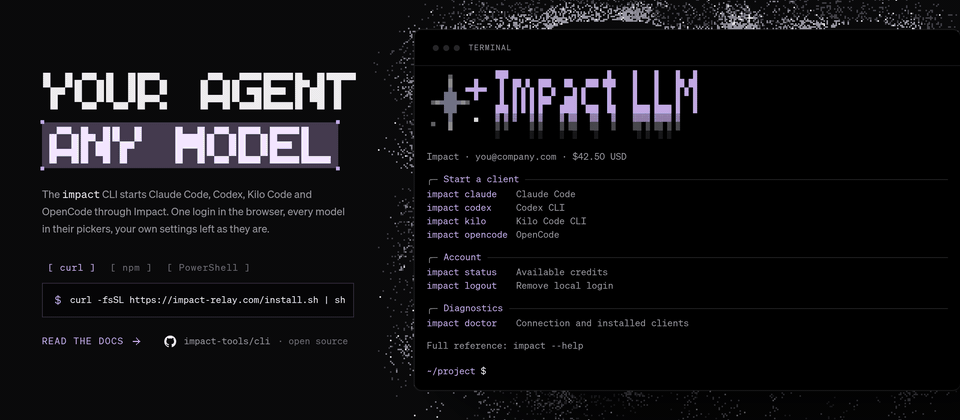

<p align="center">
  
</p>

# Impact CLI

[](https://www.npmjs.com/package/@impact-relay/cli)
[](https://nodejs.org)

Starts the coding agent you already have through [Impact Relay](https://impact-relay.com): one login in the browser, every Impact model in the agent's own picker, your own settings left as they are.

## Quick start

```sh
curl -fsSL https://impact-relay.com/install.sh | sh   # macOS and Linux
irm https://impact-relay.com/install.ps1 | iex        # Windows PowerShell

impact login                                          # approve the code in your browser
impact claude                                         # or codex, kilo, opencode, cursor, antigravity
```

Both scripts only run `npm install --global @impact-relay/cli` (Node.js 22.13 or later) and say what to do if `impact` isn't on your `PATH`. Arguments, stdin and the exit code pass through to the client, so `impact claude -p "hello"` and `impact codex exec "hello"` work as usual.

## Documentation

Everything about using the CLI lives in the docs, not here.

- [CLI reference](https://impact-relay.com/docs/cli): [install](https://impact-relay.com/docs/cli#install), [sign in](https://impact-relay.com/docs/cli#sign-in), [launch a client](https://impact-relay.com/docs/cli#launch), [local proxy](https://impact-relay.com/docs/cli#proxy), [environment variables](https://impact-relay.com/docs/cli#environment), [troubleshooting](https://impact-relay.com/docs/cli#troubleshooting)
- [Claude Code](https://impact-relay.com/docs/clients/claude-code): `impact claude`
- [Codex](https://impact-relay.com/docs/clients/codex): `impact codex`
- [Cursor](https://impact-relay.com/docs/clients/cursor): `impact cursor`
- [Kilo Code](https://impact-relay.com/docs/clients/kilo-code): `impact kilo`
- [OpenCode](https://impact-relay.com/docs/clients/opencode): `impact opencode`
- Antigravity (Agents and IDE): `impact antigravity`, no docs page yet
- [Quickstart](https://impact-relay.com/docs/quickstart), [Models](https://impact-relay.com/models), [Authentication](https://impact-relay.com/docs/authentication)

## How it works

`impact` never edits a client's own files. Each launch builds an overlay or a temporary profile that points the client at Impact, runs the client with it and removes it on exit. Cursor, Codex and Antigravity go through a background proxy on `127.0.0.1` (`impact proxy`): it keeps the Impact key, answers the native protocol where the client speaks one Impact doesn't, and forwards generation to Impact.

| Client         | How Impact is plugged in                                                               | Checked with             |
| -------------- | -------------------------------------------------------------------------------------- | ------------------------ |
| Claude Code    | launch settings: gateway endpoint, credential helper, model picker and status line     | needs 2.1.242 or later   |
| Codex          | temporary native profile with an `impact` Responses provider, through the proxy        | 0.160.0                  |
| Kilo Code      | `KILO_CONFIG_CONTENT` overlay: the full catalog under the `impact` provider            | 7.8.3                    |
| OpenCode       | `OPENCODE_CONFIG_CONTENT` overlay, the same as Kilo (a fork of it)                     | 1.18.31, 1.18.34         |
| Cursor Desktop | dedicated profile, HTTPS interception by the proxy, native RPCs answered locally       | 3.16.17                  |
| Antigravity    | stock app, Cloud Code and Gemini streaming translated to Chat Completions by the proxy | IDE 2.5.5, Agents 2.21.1 |

Rules every integration follows:

- The Impact key stays out of command arguments and generated settings: a client gets it from its child environment, or the proxy substitutes it on requests to Impact.
- A client's settings, MCP servers, sessions and history stay where they are; temporary authentication, profiles and certificates are removed when the process exits.
- Expected failures are a `CliError` with one line: `main.ts` prints it and exits with code 1.

Source layout, under `src/`:

- `commands/` defines the commands and `Command.ts` assembles them; `impact helper …` are unlisted commands that clients call back during a launch.
- `clients/` has one folder per client, plus `Launch.ts` (the list and the runner) and `Client.ts` (what they share). Kilo and OpenCode share `clients/opencode/`.
- `proxy/` is the background proxy for Cursor, Codex and Antigravity: its files, the process and its control requests.
- `auth/` is device authorization and key input; `config/` validates connections and stores credentials.
- `api/` calls Impact: `Http.ts` makes authenticated JSON requests, the rest read models, usage and spend.
- `schemas/` is the API contract, copied from the gateway's shared schemas so this repository builds alone. Keep it in sync when the gateway's API changes. It carries no model catalog: the models, their names and prices come from `GET /v1/models` on every launch, so a new or repriced model never needs a CLI release. `ModelVocabulary.ts` holds only what doesn't change with the catalog (reasoning efforts, Claude's alternative spellings).
- `process/` builds the command lines clients use to call back into this CLI.

Built on [Effect](https://effect.website): argument parsing, HTTP and the scoped cleanup of processes, sockets and temporary files. The Node platform process spawner lets both the Node bundle and the compiled Bun executable run.

## Development

This repository builds on its own with Bun 1.4.2:

```sh
bun install --frozen-lockfile
bun run typecheck
bun run test
bun run dev login       # any command: bun run dev claude, bun run dev status, …
bun run build           # dist/impact.js, runs on Node
bun run build:bin       # dist/impact, a compiled executable
```

`bun run dev` keeps the caller's working directory and selects `http://impactllm.localhost:4420`; HTTP is accepted only for loopback hosts. These variables matter for development; the user-facing ones are in the [docs](https://impact-relay.com/docs/cli#environment):

| Variable                 | Purpose                                                             |
| ------------------------ | ------------------------------------------------------------------- |
| `IMPACT_BASE_URL`        | Impact origin without `/v1`; `login --base-url` takes precedence    |
| `IMPACT_ANTIGRAVITY_BIN` | Antigravity executable                                              |
| `IMPACT_CURSOR_APP_DIR`  | Installed Cursor application or resources directory for descriptors |
| `IMPACT_CURSOR_DEBUG`    | `1` prints route and transport diagnostics                          |
| `CODEX_HOME`             | Existing Codex configuration directory                              |

## Build and release

The `Build and release` workflow (`.github/workflows/publish.yml`) runs on pull requests, pushes to `main` and manual dispatch: locked install, type check, tests, the Node bundle, a packed `.tgz` that it installs and runs, and an `npm-package` artifact.

[release-please](https://github.com/googleapis/release-please) cuts releases from [Conventional Commits](https://www.conventionalcommits.org/). On every push to `main` it opens or updates a release PR that bumps `package.json`, `.release-please-manifest.json` and `CHANGELOG.md`; before 1.0, `feat` bumps the minor version and `fix` the patch. Merging it tags `v<version>`, creates the GitHub Release and publishes that commit's archive to npmjs.com through [npm trusted publishing](https://docs.npmjs.com/trusted-publishers), so no token is stored. The repository must allow GitHub Actions to create pull requests (Settings → Actions → General).
